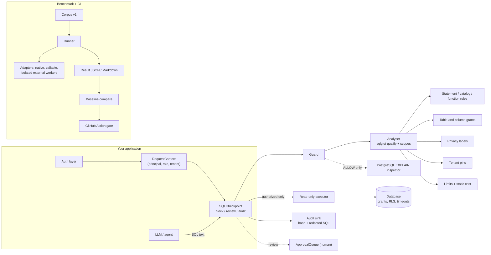

# SQLGuard Ninja

**Security testing, policy enforcement, agent integration, privacy analysis and CI
benchmarking for LLM-generated SQL.**

[](https://github.com/Pratik653/SQLGuard_Ninjapy/actions/workflows/ci.yml)
[](https://pypi.org/project/sqlguard-ninja/)


When an LLM writes SQL, the system prompt is not a security boundary. SQLGuard Ninja sits
between the model and the database. It checks every statement against a declared policy for
the *authenticated* caller: which tables and columns a role may use, which data classes may
appear only in aggregates or only after human approval, and which tenant the caller belongs
to. It records an audit trail and gives the agent an explanation it can act on.

It ships with a labelled benchmark corpus (551 cases, 1,044 dialect evaluations) and a
regression gate for CI. The same benchmark harness can evaluate other open-source guards
side by side.

> **One layer, not the only one.** Static SQL inspection cannot guarantee database security.
> Use a read-only least-privilege role, row-level security and statement timeouts as well.
> See the [threat model](https://github.com/Pratik653/SQLGuard_Ninjapy/blob/main/docs/security/THREAT_MODEL.md).

## What it does

| Workstream | What you get | Status |
|---|---|---|
| **Policy engine** | Read-only enforcement, table/column grants, tenant isolation, function and catalog rules, structural limits. Built on [sqlglot](https://github.com/tobymao/sqlglot). Fails closed when analysis is incomplete. | PostgreSQL + SQLite tested |
| **Privacy pack** | Explicit classification labels, `deny` / `aggregate_only` / `review` per role, JSON-path labels, lineage through CTEs and derived tables, small-cohort review, minimisation hints and alternatives | implemented |
| **Agent integrations** | `SQLCheckpoint` with block / review / audit modes, hash-bound single-use approvals, retry lock-out, redacted audit events. LangChain tool, LangGraph nodes, FastAPI router | implemented |
| **Benchmark engine** | Versioned corpus with per-file SHA-256 hashes, internal and independent tiers, metrics (recall, precision, F1, FPR, FNR with 95% Wilson intervals, exact match, throughput, latency percentiles, per category/dialect/tier), adapters for native, callable and isolated external validators, JSON, CSV and Markdown reports | implemented |
| **Query cost** | Explainable static score; optional PostgreSQL `EXPLAIN (FORMAT JSON)` inspection, gated and read-only | implemented |
| **CI** | Composite GitHub Action and CLI gate: security, usability, label-change and error regressions against an approved baseline | implemented |

Not yet included: governed writes (all writes are denied in v0.1); benchmark cases for
restricted functions and system catalogs (the rules exist, but the corpus does not cover
them); dialects beyond PostgreSQL and SQLite (they parse, but are untested). Full list:
[KNOWN_LIMITATIONS.md](https://github.com/Pratik653/SQLGuard_Ninjapy/blob/main/KNOWN_LIMITATIONS.md).

## Architecture



Design decisions and their trade-offs are recorded in
[ARCHITECTURE_DECISIONS.md](https://github.com/Pratik653/SQLGuard_Ninjapy/blob/main/docs/architecture/ARCHITECTURE_DECISIONS.md).

## Five-minute quick start

```bash
python -m pip install sqlguard-ninja            # core: sqlglot, pydantic, PyYAML
python -m pip install "sqlguard-ninja[all]"     # + LangChain, LangGraph, FastAPI, psycopg
```

Extras: `langchain`, `langgraph`, `fastapi`, `postgres`, `all`. Python 3.11+.

Validate a query against the bundled reference policy (`builtin:retail_saas`, a synthetic
multi-tenant retail schema):

```bash
sqlninja validate --policy builtin:retail_saas --role support_analyst --tenant 1   --sql "SELECT o.id FROM orders o WHERE o.tenant_id = 1 OR 1 = 1"
```

```
DENY:
  [deny] tenant.missing_predicate: Every read of table 'orders' must filter on the caller's tenant. Suggestion: Add `o.tenant_id = :tenant_id` to the WHERE clause of the scope that reads this table.
```

Exit codes: 0 allow, 1 deny, 3 review, 2 usage error.

Run the bundled benchmark corpus, then start your own project:

```bash
sqlninja benchmark run --dataset builtin:v1 --output results/native.json
sqlninja init my-project && cd my-project
sqlninja benchmark run --config sqlninja.yaml
```

The runnable demos live in the repository (deterministic; no API key needed):

```bash
git clone https://github.com/Pratik653/SQLGuard_Ninjapy.git && cd SQLGuard_Ninjapy
python -m pip install -e ".[all]"
python examples/sdk/quickstart.py
python examples/sqlite/text_to_sql_demo.py
python examples/langgraph/sql_agent_demo.py
```

## Python SDK

```python
from sqlguard_ninja import Guard, Policy

from sqlguard_ninja.benchmarking.builtin import resolve

guard = Guard(Policy.from_file(resolve("builtin:retail_saas", "policy")))
result = guard.validate(
    "SELECT department, AVG(salary) FROM employees GROUP BY department",
    role="hr_analyst",
    dialect="postgres",
)
result.allowed  # True
result.findings  # () - structured Finding objects with rule_id, action, message, remediation

guard.validate("SELECT full_name, salary FROM employees", role="hr_analyst").explain()
# DENY:
#   [deny] privacy.aggregate_only: The column 'employees.salary' may only be used inside
#   statistical aggregates (COUNT, SUM, AVG, ...), not as individual values. ...
```

## LangGraph

```python
from sqlguard_ninja.integrations import RequestContext, SQLCheckpoint
from sqlguard_ninja.integrations.langgraph import (
    CONTEXT_KEY,
    make_execute_node,
    make_guard_node,
    route_after_guard,
)

checkpoint = SQLCheckpoint(guard, mode="block", max_denied_attempts=3)
graph.add_node("guard", make_guard_node(checkpoint))
graph.add_node("execute", make_execute_node(checkpoint, executor))  # re-validates
graph.add_conditional_edges(
    "guard", route_after_guard(3), {"execute": "execute", "revise": "generate", "end": END}
)

ctx = RequestContext(principal=user.id, role=user.role, tenant_id=user.tenant_id)
app.invoke(state, config={"configurable": {CONTEXT_KEY: ctx}})  # nodes cannot alter config
```

More in [AGENT_INTEGRATION.md](https://github.com/Pratik653/SQLGuard_Ninjapy/blob/main/docs/guides/AGENT_INTEGRATION.md): the LangChain tool (its
schema accepts only `query`), the FastAPI router, review-mode approvals and audit sinks.

## Privacy policies

Sensitivity comes from labels **you** assign in the policy, never from column names, and
access is resolved per role:

```yaml
labels:
  payment_card: {sensitivity: critical, masking: use card_last4 and card_brand}
  financial:    {sensitivity: high}
catalog:
  tables:
    payments:
      tenant_column: tenant_id
      columns:
        card_number: {labels: [payment_card], alternatives: [card_last4]}
        card_last4: text
roles:
  support_analyst:
    tables: {payments: [id, tenant_id, card_last4, card_brand, amount, status]}
    labels: {payment_card: deny, financial: deny}
  hr_analyst:
    tables: {employees: "*"}
    labels: {hr: allow, financial: aggregate_only}   # salary only inside COUNT/SUM/AVG
```

```text
support_analyst> SELECT p.card_number FROM payments p WHERE p.tenant_id = 1
DENY:
  [deny] privacy.label_denied: The column 'payments.card_number' contains classified data (payment_card) that this role may not access. Suggestion: Use column 'payments.card_last4' instead. ...

hr_analyst> SELECT AVG(salary) FROM employees WHERE id = 7
REVIEW:
  [review] privacy.small_cohort: An aggregate of restricted data is filtered or grouped by an identifying column, which can reveal individual values. ...
```

Labels also apply to paths inside JSON columns (`profile->'health'->>'allergies'`).
`sqlninja policy suggest` proposes labels from column names for a human to review; those
suggestions are never enforced. This is a technical control, not a certification of GDPR
compliance. Full semantics: [POLICY_REFERENCE.md](https://github.com/Pratik653/SQLGuard_Ninjapy/blob/main/docs/guides/POLICY_REFERENCE.md).

## Policy as code

Roles can inherit (`extends`), and explicit denies cannot be relaxed by a child. Every decision
carries the policy revision, the policy fingerprint and a decision id. Review changes before
activating them:

```bash
sqlninja policy template multi_tenant_saas --output policy.yaml
sqlninja policy diff old.yaml policy.yaml --fail-on-relaxation
sqlninja policy simulate --policy old.yaml --against policy.yaml --cases cases.yaml
sqlninja policy explain --policy policy.yaml --role support --column customers.email
```

Optional: `SQLCheckpoint(..., rewrite_tenant_filters=True)` adds missing tenant filters
through the AST and executes only the re-validated rewrite. See
[POLICY_AS_CODE.md](https://github.com/Pratik653/SQLGuard_Ninjapy/blob/main/docs/guides/POLICY_AS_CODE.md).

## MCP server

Let MCP-compatible agents check SQL against your policy before running it anywhere:

```bash
python -m pip install "sqlguard-ninja[mcp]"
sqlninja mcp --policy builtin:retail_saas --role support_analyst --tenant 1
```

The four tools are `validate_sql`, `explain_policy_decision`, `inspect_query_cost` and
`get_policy_capabilities`. The role and tenant are fixed server-side, the server never connects
to a database, and it exposes no execution tool. Tested with the official MCP Python SDK
client over stdio. See [MCP_INTEGRATION.md](https://github.com/Pratik653/SQLGuard_Ninjapy/blob/main/docs/guides/MCP_INTEGRATION.md).

## Interactive playground

A web app on a synthetic retail database. It has:

* three enforceable roles (Sales Analyst, Customer Support, Store Manager)
* example queries, with explanations and how-to-fix hints
* lineage, tenant-isolation demonstrations and role permissions
* a benchmark dashboard that separates internal from independent results

```bash
python -m pip install "sqlguard-ninja[demo]"
sqlninja demo serve          # http://127.0.0.1:8000
```

Allowed queries run in a restricted in-memory sandbox. The database itself enforces this
with an authorizer allowlist, engine limits and a time budget. A static build
(`scripts/build_static_demo.py`) runs the whole thing in the browser with Pyodide, with no
server. See [DEPLOYMENT.md](https://github.com/Pratik653/SQLGuard_Ninjapy/blob/main/docs/guides/DEPLOYMENT.md)
for Docker, Compose and Kubernetes.

## Observability and SARIF

```bash
python -m pip install "sqlguard-ninja[otel,prometheus]"
sqlninja scan sql/ --policy policy.yaml --role reporting --tenant 1 --format sarif --output sqlninja.sarif
```

`Telemetry(tracer=..., metrics=GuardMetrics())` adds OpenTelemetry spans and Prometheus metrics
to the checkpoint: decisions, findings by rule, latency, errors, resource-limit rejections and
checkpoint outcomes. By default no signal contains SQL text, literals, request-context values,
tenant ids or principals, and tests check this with canary values. A Grafana dashboard
(`deploy/grafana/`) and a synthetic-traffic Prometheus/Grafana stack are included. SARIF output
validates against the OASIS 2.1.0 schema. See [OBSERVABILITY.md](https://github.com/Pratik653/SQLGuard_Ninjapy/blob/main/docs/guides/OBSERVABILITY.md).

## Query cost analysis

Every validation includes an explainable static score that uses the catalog's
`estimated_rows`:

```text
platform_admin> SELECT o.id, i.id FROM orders o CROSS JOIN order_items i
DENY:
  [deny] cost.static_score: Estimated query cost risk is 100/100: join with i has no join condition (Cartesian product); o has an estimated 10,000,000 rows and is read without a filter; ...
```

Optionally, compare it with PostgreSQL's planner. This runs `EXPLAIN (FORMAT JSON)` only,
never `ANALYZE`, and only on SQL the guard allowed, inside a read-only, time-limited,
rolled-back transaction:

```python
from sqlguard_ninja.query_cost.postgres import PostgresPlanInspector

report = PostgresPlanInspector(guard, lambda: psycopg.connect(READER_DSN)).inspect(
    sql, role="support_analyst", context={"tenant_id": 1}
)
report.total_cost, report.plan_rows, report.static.score, report.findings
```

See [QUERY_COST.md](https://github.com/Pratik653/SQLGuard_Ninjapy/blob/main/docs/guides/QUERY_COST.md) and `examples/postgresql/plan_inspection_demo.py`.

## Benchmark

```bash
sqlninja benchmark run --dataset builtin:v1 --adapter native
python scripts/setup_external_adapters.py          # (repository) isolated venvs for other tools
sqlninja benchmark run --dataset builtin:v1 --adapter external:sql-guardrail
sqlninja benchmark compare --baseline benchmarks/baselines/native.json --candidate results/latest.json
```

Results for corpus v1.2.0 (577 cases, 1,070 evaluations; SQLGuard Ninja 0.5.0; Windows 11,
Python 3.11). Intervals are 95% Wilson intervals. Details, CSV and raw files:
[RESULTS_v1.2.md](https://github.com/Pratik653/SQLGuard_Ninjapy/blob/main/docs/benchmarks/RESULTS_v1.2.md).

| Validator | Recall (95% CI) | Precision | F1 | FPR (95% CI) | Recall / FPR within declared capability | p95 ms |
|---|---:|---:|---:|---:|---:|---:|
| SQLGuard Ninja 0.5.0 | 100.0% (99.4–100.0) | 100.0% | 1.000 | 0.0% (0.0–0.9) | 100.0% / 0.0% | 3.36 |
| sql-guardrail 0.5.2 | 98.2% (96.9–99.0) | 84.7% | 0.909 | 24.8% (21.1–29.0) | 98.3% / 19.7% | 1.84 |
| agent-sql-guard 0.2.0 | 66.8% (63.0–70.4) | 85.1% | 0.748 | 16.3% (13.2–20.0) | 89.4% / 17.7% | 1.44 |
| krish2105/sqlguard 0.1.0 | 64.8% (61.0–68.5) | 89.4% | 0.752 | 10.7% (8.2–14.0) | 83.5% / 5.2% | 1.42 |

**All of these are internal results.** The corpus was written by this project, alongside the
engine. The native 100% shows consistency with the documented semantics, not independent
detection quality. No independently sourced dataset exists yet ([intake rules](https://github.com/Pratik653/SQLGuard_Ninjapy/blob/main/benchmarks/datasets/external/README.md),
issue #6). Reports keep `internal` and `independent` tiers separate, and they also separate
policy denials from unsupported-SQL denials. Methodology and bias review:
[BENCHMARK_METHODOLOGY.md](https://github.com/Pratik653/SQLGuard_Ninjapy/blob/main/docs/guides/BENCHMARK_METHODOLOGY.md),
[BENCHMARK_BIAS_REVIEW.md](https://github.com/Pratik653/SQLGuard_Ninjapy/blob/main/docs/guides/BENCHMARK_BIAS_REVIEW.md).

## How it relates to existing tools

SQLGuard Ninja uses **sqlglot** for parsing, dialects and scope analysis, and does not
re-implement them. [sql-guardrail](https://github.com/nickusevich/sql-guardrail) is a
thorough read-only validator with a tautology catch-all, which this project does not
duplicate. [agent-sql-guard](https://github.com/sakura-sky/sql-guard) has a careful
schema-less PII denylist. What SQLGuard Ninja adds: role- and label-based policies, the agent
checkpoint contract, a shared benchmark with isolated adapters, planner inspection, and the
CI gate. Full comparison: [COMPETITIVE_ANALYSIS.md](https://github.com/Pratik653/SQLGuard_Ninjapy/blob/main/docs/research/COMPETITIVE_ANALYSIS.md).

## Security limitations

* Static inspection can be wrong where sqlglot and the real database parse SQL differently.
  Only PostgreSQL and SQLite are tested.
* It cannot see inside views or user-defined functions, and it does not stop inference
  across many permitted queries.
* Cost scores and planner estimates are indicators, not guarantees.
* v0.1 denies all writes.
* The benchmark has no restricted-function or system-catalog cases yet. The rules exist,
  but those two categories are not measured.

Use database grants, row-level security and timeouts as the authoritative controls. See the
[threat model](https://github.com/Pratik653/SQLGuard_Ninjapy/blob/main/docs/security/THREAT_MODEL.md), [limits of static analysis](https://github.com/Pratik653/SQLGuard_Ninjapy/blob/main/docs/security/STATIC_ANALYSIS_LIMITS.md),
the [benchmark bias review](https://github.com/Pratik653/SQLGuard_Ninjapy/blob/main/docs/guides/BENCHMARK_BIAS_REVIEW.md) and [KNOWN_LIMITATIONS.md](https://github.com/Pratik653/SQLGuard_Ninjapy/blob/main/KNOWN_LIMITATIONS.md).

## Roadmap

Next: restricted-function and system-catalog benchmark cases (issue #5), an independent
held-out corpus (issue #6) and public hosting of the playground. Later:
governed writes, and database-verified SQL Server and Oracle support. Details in [ROADMAP.md](https://github.com/Pratik653/SQLGuard_Ninjapy/blob/main/ROADMAP.md).

## Links

* Repository: https://github.com/Pratik653/SQLGuard_Ninjapy
* Releases: https://github.com/Pratik653/SQLGuard_Ninjapy/releases
* PyPI: https://pypi.org/project/sqlguard-ninja/
* Issues: https://github.com/Pratik653/SQLGuard_Ninjapy/issues
* Security policy: [SECURITY.md](https://github.com/Pratik653/SQLGuard_Ninjapy/blob/main/SECURITY.md) · Contributing: [CONTRIBUTING.md](https://github.com/Pratik653/SQLGuard_Ninjapy/blob/main/CONTRIBUTING.md)

## Documentation

* [Policy reference](https://github.com/Pratik653/SQLGuard_Ninjapy/blob/main/docs/guides/POLICY_REFERENCE.md)
* [Policy as code](https://github.com/Pratik653/SQLGuard_Ninjapy/blob/main/docs/guides/POLICY_AS_CODE.md)
* [MCP integration](https://github.com/Pratik653/SQLGuard_Ninjapy/blob/main/docs/guides/MCP_INTEGRATION.md)
* [Agent integration](https://github.com/Pratik653/SQLGuard_Ninjapy/blob/main/docs/guides/AGENT_INTEGRATION.md)
* [Query cost](https://github.com/Pratik653/SQLGuard_Ninjapy/blob/main/docs/guides/QUERY_COST.md)
* [CI integration](https://github.com/Pratik653/SQLGuard_Ninjapy/blob/main/docs/guides/CI_INTEGRATION.md)
* [Playground and deployment](https://github.com/Pratik653/SQLGuard_Ninjapy/blob/main/docs/guides/DEPLOYMENT.md)
* [Observability and SARIF](https://github.com/Pratik653/SQLGuard_Ninjapy/blob/main/docs/guides/OBSERVABILITY.md)
* [Database compatibility](https://github.com/Pratik653/SQLGuard_Ninjapy/blob/main/docs/guides/DATABASE_COMPATIBILITY.md)
* [Benchmark methodology](https://github.com/Pratik653/SQLGuard_Ninjapy/blob/main/docs/guides/BENCHMARK_METHODOLOGY.md)
* [Threat model](https://github.com/Pratik653/SQLGuard_Ninjapy/blob/main/docs/security/THREAT_MODEL.md)
* [Limits of static SQL analysis and dialect support](https://github.com/Pratik653/SQLGuard_Ninjapy/blob/main/docs/security/STATIC_ANALYSIS_LIMITS.md)
* [Benchmark bias review](https://github.com/Pratik653/SQLGuard_Ninjapy/blob/main/docs/guides/BENCHMARK_BIAS_REVIEW.md)
* [Architecture decisions](https://github.com/Pratik653/SQLGuard_Ninjapy/blob/main/docs/architecture/ARCHITECTURE_DECISIONS.md)
* [Known limitations](https://github.com/Pratik653/SQLGuard_Ninjapy/blob/main/KNOWN_LIMITATIONS.md) · [Roadmap](https://github.com/Pratik653/SQLGuard_Ninjapy/blob/main/ROADMAP.md) · [Changelog](https://github.com/Pratik653/SQLGuard_Ninjapy/blob/main/CHANGELOG.md)

## Supported versions

* Python 3.11, 3.12, 3.13 (CI matrix on Linux and Windows).
* SQL dialects: **PostgreSQL** (tested against PostgreSQL 16), **SQLite**, and **MySQL 8**
  (tested against MySQL 8.4 in CI, within the documented scope: identifier case is not folded,
  named placeholders only). SQL Server and Oracle are parser-level **experimental**; others are
  untested. See the [compatibility matrix](https://github.com/Pratik653/SQLGuard_Ninjapy/blob/main/docs/guides/DATABASE_COMPATIBILITY.md).

## Development

```bash
python -m pip install -e ".[dev]"
ruff check src tests scripts examples && ruff format --check src tests scripts examples
mypy
pytest                          # PostgreSQL tests run if SQLNINJA_PG_DSN is set or pgserver is installed
python scripts/generate_corpus.py --check
```

See [CONTRIBUTING.md](https://github.com/Pratik653/SQLGuard_Ninjapy/blob/main/CONTRIBUTING.md). Report vulnerabilities privately per
[SECURITY.md](https://github.com/Pratik653/SQLGuard_Ninjapy/blob/main/SECURITY.md).

## Licence

Apache-2.0. No third-party code is vendored; dependencies and their licences are listed in
[THIRD_PARTY_NOTICES.md](https://github.com/Pratik653/SQLGuard_Ninjapy/blob/main/THIRD_PARTY_NOTICES.md). All benchmark data is synthetic.
